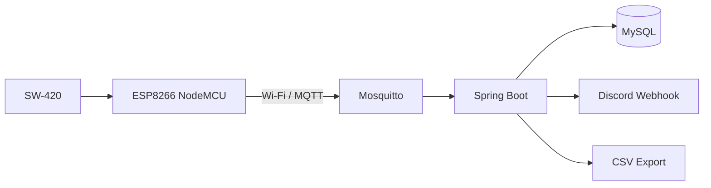

# Dorm Laundry Alarm

ESP8266과 SW-420 진동 센서로 세탁기의 동작 상태를 수집하고, MQTT와 Spring Boot를 거쳐 MySQL에 저장한 뒤 세탁 완료 후보를 Discord로 알리는 IoT 프로토타입입니다.

> 이 저장소는 기술 프로토타입입니다. 공용 세탁기에 대한 현장 부착 승인을 받지 못했으므로 기숙사 실기기 설치·검증은 진행하지 않았습니다. 시설물에는 관리 주체의 명시적인 허가 없이 센서나 전원 장치를 설치하지 않습니다.

## 데이터 흐름



ESP8266은 두 종류의 메시지를 발행합니다.

| MQTT 토픽 | 페이로드 | 용도 |
| --- | --- | --- |
| `laundry/vibration/1` | `0` 또는 `1` | 상태 변화 및 주기적 상태 보고 |
| `laundry/telemetry/1` | `sample_count,vibration_count,window_ms` | 1초 단위 원시 집계 데이터 저장 |

## 구현 상태

- [x] ESP8266 Wi-Fi 및 MQTT 재연결
- [x] SW-420 상태 발행
- [x] 1초 단위 진동 텔레메트리 발행
- [x] Spring Boot MQTT 구독
- [x] MySQL 기기 상태 및 텔레메트리 저장
- [x] 무진동 시간 기반 완료 후보 판정
- [x] Discord 웹훅 알림
- [x] 텔레메트리 CSV 내보내기
- [x] PC·휴대폰 반응형 대시보드 및 데모 모드
- [x] 실험별 시작·본세탁·헹굼·탈수·실제 종료 시각과 메모 저장
- [x] 실험 구간 진동 CSV 및 관찰 기록 CSV 내보내기
- [ ] 실제 세탁 데이터 기반 임계값 보정
- [ ] 중간 정지와 실제 종료를 구분하는 상태 머신
- [ ] 허가된 환경에서의 장시간 실기기 검증

현재 로컬 프로필의 완료 임계값은 빠른 기능 시험을 위해 10초입니다. 운영 기본값은 180초이지만, 두 값 모두 실제 세탁 데이터로 보정하기 전의 임시값입니다.

## 기술 구성

- Hardware: ESP8266 NodeMCU, SW-420
- Firmware: Arduino C++, ESP8266WiFi, PubSubClient
- Messaging: Mosquitto MQTT
- Backend: Java 21, Spring Boot, Spring Integration MQTT, Spring Data JPA
- Database: MySQL 8
- Notification: Discord Webhook

## 저장소 구조

```text
.
├─ firmware/
│  ├─ laundry_sensor/       # Wi-Fi/MQTT 및 텔레메트리 펌웨어
│  └─ sw420_serial_test/     # 센서 단독 시리얼 테스트
├─ scripts/                 # 로컬 DB 초기화 및 서버 실행
├─ src/main/                # Spring Boot 애플리케이션
├─ docs/VALIDATION_PLAN.md  # 제한 사항과 후속 검증 계획
└─ LOCAL_SETUP.md           # Windows 로컬 실행 절차
```

## 빠른 시작

화면을 먼저 살펴보려면 [온라인 데모](https://dorm-laundry-lab.clover9593.chatgpt.site)를 열면 됩니다(소유자 비공개). 데모는 예시 데이터를 표시하며 기록은 브라우저에만 보관합니다. 실제 센서와 연결할 때는 아래 로컬 서버를 사용합니다.

필수 프로그램은 Java 21, MySQL 8, Mosquitto입니다. Windows PowerShell 기준 전체 절차는 [LOCAL_SETUP.md](LOCAL_SETUP.md)에 정리되어 있습니다.

```powershell
# MySQL DB와 로컬 전용 계정 생성(최초 1회)
Get-Content .\scripts\init-local-db.sql |
  & 'C:\Program Files\MySQL\MySQL Server 8.0\bin\mysql.exe' -u root -p

# 웹훅을 파일에 저장하지 않고 마스킹 입력하여 실행
.\scripts\run-local.ps1 -PromptForWebhook
```

실행 후 [로컬 대시보드](http://localhost:8081)를 엽니다. 같은 네트워크의 휴대폰에서는 `http://PC의-IP주소:8081`로 접속합니다. 사용 방법과 API는 [대시보드 안내](docs/DASHBOARD.md)를 참고하세요.

서버가 실행 중이면 아래 주소에서 저장된 텔레메트리를 CSV로 내려받을 수 있습니다.

```text
http://localhost:8081/api/telemetry/export.csv
```

## 펌웨어 설정

1. `firmware/laundry_sensor/secrets.h.example`을 같은 폴더의 `secrets.h`로 복사합니다.
2. Wi-Fi SSID, 비밀번호, MQTT 브로커 주소를 자신의 환경에 맞게 입력합니다.
3. Arduino IDE에서 `laundry_sensor.ino`를 ESP8266 NodeMCU에 업로드합니다.

`secrets.h`는 Git에서 제외됩니다. 실제 Wi-Fi 비밀번호, Discord 웹훅, 운영 DB 비밀번호를 저장소에 커밋하지 마세요.

## 검증 범위와 한계

로컬 환경에서 다음 흐름은 기능 검증했습니다.

```text
MQTT 발행 → Mosquitto → Spring Boot → MySQL → CSV/Discord
```

기숙사 공용 세탁기는 관리업체가 외판 센서 부착을 허가하지 않아 현장 데이터를 수집하지 않았습니다. 따라서 현재 완료 판정은 실제 제품에 적용 가능한 정확도를 주장하지 않습니다. 허가된 개인 세탁기 또는 소형 진동 실험 장치에서 정상 동작, 중간 정지, 짧은 충격, 통신 끊김을 재현한 뒤 상태 머신과 임계값을 보정해야 합니다. 구체적인 시나리오는 [검증 계획](docs/VALIDATION_PLAN.md)을 참고하세요.

## 안전 원칙

- 관리 주체의 허가 없이 공용 설비에 장치를 부착하지 않습니다.
- 세탁기 분해, 전기함 접근, 콘센트 변경을 하지 않습니다.
- 센서 외 장치와 전원은 물기가 없는 독립된 위치에 둡니다.
- 시설물 훼손 가능성이 있는 접착제나 고정 방식을 사용하지 않습니다.

## 향후 개선

1. 허가된 환경에서 한 사이클 이상의 실제 데이터 수집
2. CSV 데이터를 MQTT로 재생하는 테스트 도구 추가
3. `IDLE → RUNNING → POSSIBLY_FINISHED → FINISHED` 상태 머신 적용
4. MQTT 연결 단절과 실제 무진동 상태 분리
5. 동일 데이터셋에 대한 오탐·미탐·알림 지연 평가
